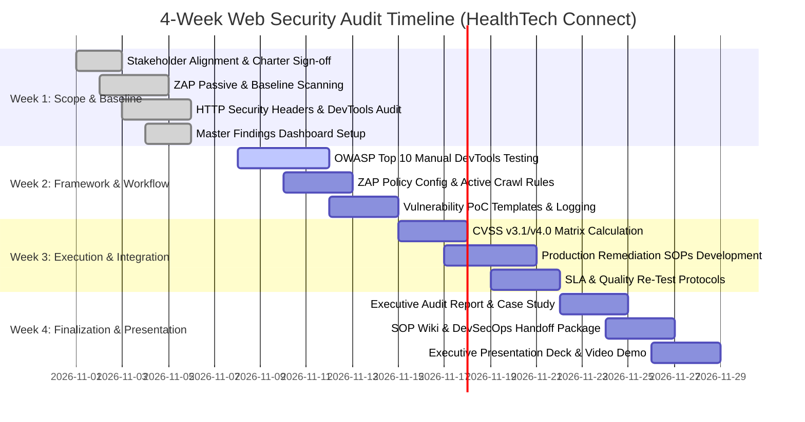

# PROJECT CHARTER & KPI DOCUMENT
## Web Application Security Audit & OWASP Top 10:2021 Compliance Assessment
### Target System: HealthTech Connect Clinical & Patient Engagement Platform

---

## 1. Executive Summary & Project Context
**HealthTech Connect** operates a cloud-native Telehealth and Electronic Health Records (EHR) synchronization web application. The platform processes and stores Protected Health Information (PHI/ePHI) for over 150,000 active patients, interfacing primary care physicians, specialists, clinical lab systems, and pharmacy benefit managers.

This 4-week audit engagement establishes a rigorous security baseline, evaluates the application against the **OWASP Top 10 (2021)** security risks, and assesses alignment with the **Health Insurance Portability and Accountability Act (HIPAA) Security Rule (45 CFR Part 160 and Part 164, Subparts A and C)**.

---

## 2. Project Scope Boundaries

### 2.1 In-Scope Target Systems & Endpoints
The following public-facing and authenticated web assets, REST/GraphQL APIs, and microservice ingress controllers are strictly within the scope of automated vulnerability scanning, manual inspection, and security architecture review:

| Asset Name | Target URL / FQDN | Environment | Architectural Role & Tech Stack | Data Sensitivity |
| :--- | :--- | :--- | :--- | :--- |
| **Patient Web Portal** | `https://portal.healthtechconnect.io` | Staging / Pre-Prod | React 18, Vite, Tailwind CSS, SPA | ePHI, Demographics, Patient Records |
| **Physician / Admin Console**| `https://clinical.healthtechconnect.io` | Staging / Pre-Prod | Next.js 14, SSR, Redux Toolkit | Prescriptions, Clinical Notes, Staff Auth |
| **Core API Gateway** | `https://api.healthtechconnect.io/v1` | Staging / Pre-Prod | Node.js (Express), Kong Gateway, Nginx Ingress | Bearer Token Auth, Route Dispatcher |
| **EHR Microservice (FHIR)** | `https://ehr-sync.healthtechconnect.io/fhir/r4` | Staging / Pre-Prod | Python (FastAPI), SQLAlchemy, PostgreSQL 15 | HL7/FHIR v4 Datastores, Diagnostic Reports |
| **Identity & SSO Service** | `https://auth.healthtechconnect.io` | Staging / Pre-Prod | Go (Golang), Keycloak IdP, OAuth2.0 / OIDC | Credentials, MFA Tokens, Session Store |

### 2.2 Out-of-Scope Assets & Prohibited Activities
To prevent operational disruption, legal violations, and non-compliance with third-party SLAs, the following boundaries are enforced:

- **Third-Party Payment Processors**: `https://api.stripe.com` and external merchant redirect endpoints.
- **Production Infrastructure**: Live production instances (`*.prod.healthtechconnect.io`) and real-time patient databases.
- **Denial of Service (DoS / DDoS)**: High-volume volumetric stress testing, network-layer SYN floods, and application-layer exhaustion attacks.
- **Social Engineering & Phishing**: Spear-phishing of medical personnel, clinical staff, or helpdesk agents.
- **Physical Security**: Physical data centers, office premises, and clinician endpoint hardware.

---

## 3. Regulatory & Compliance Mapping Framework

| Standard / Regulation | Mandatory Control Reference | Audit Requirement |
| :--- | :--- | :--- |
| **HIPAA Security Rule** | 45 CFR § 164.312(a)(1) — Access Control | Implement unique user identification, emergency access procedures, and automatic logoff mechanisms. |
| **HIPAA Security Rule** | 45 CFR § 164.312(c)(1) — Data Integrity | Protect ePHI from improper alteration or destruction through verification of digital signatures and input validation. |
| **HIPAA Security Rule** | 45 CFR § 164.312(e)(1) — Transmission Security | Enforce end-to-end encryption of all electronic protected health information across public transit (TLS 1.3). |
| **OWASP Top 10:2021** | A01:2021 – A10:2021 | Comprehensive verification against Broken Access Control, Cryptographic Failures, Injection, and Insecure Design. |
| **NIST SP 800-53 Rev. 5** | SC-8, SC-13, AC-3, SI-10 | Cryptographic protection, information system access enforcement, and input validation validation controls. |

---

## 4. Key Performance Indicators (KPIs) & Success Metrics

The project will be evaluated against strict quantifiable metrics categorized across coverage, vulnerability resolution, and process maturity:

```
+-----------------------------------------------------------------------------------------+
|                               PROJECT KPI TARGETS                                       |
+------------------------------------+--------------------------+-------------------------+
| Metric Category                    | KPI Definition           | Target Threshold        |
+------------------------------------+--------------------------+-------------------------+
| Audit Coverage                     | Attack Surface Scanned   | 100% In-Scope Endpoints |
| OWASP Top 10:2021 Verification     | Rule Coverage            | 10/10 Categories Tested |
| Critical Flaw Triage & SLA         | Time to Confirm Critical | < 24 Hours              |
| High-Severity Resolution SLA       | Remediation Verification | < 72 Hours              |
| Medium-Severity Resolution SLA     | Remediation Verification | < 14 Calendar Days      |
| Low / Informational Resolution SLA | Remediation Verification | < 30 Calendar Days      |
| False Positive Margin              | ZAP Scan Validation Rate | < 5% Confirmed FP       |
| Security Header Compliance Score   | Mozilla Observatory      | Grade A+ (>= 100/100)   |
| DevSecOps Artifact Deliverables    | SOPs & Verification POCs | 100% Peer-Approved      |
+------------------------------------+--------------------------+-------------------------+
```

---

## 5. Stakeholder Matrix & Responsibilities (RACI)

| Role | Name / Title | Responsible (R) | Accountable (A) | Consulted (C) | Informed (I) |
| :--- | :--- | :---: | :---: | :---: | :---: |
| **Lead Security Auditor** | DevSecOps Lead (You) | [X] | [ ] | [ ] | [ ] |
| **HIPAA Security Officer** | Dr. A. Vance, CISO | [ ] | [X] | [X] | [ ] |
| **Lead Full-Stack Architect**| R. Patel, Principal Eng | [X] | [ ] | [X] | [ ] |
| **Backend & FHIR Lead** | S. Chen, Sr. Python Dev | [X] | [ ] | [X] | [ ] |
| **DevOps / SRE Lead** | M. Keller, Infrastructure | [X] | [ ] | [X] | [ ] |
| **Executive Leadership** | VP of Healthcare Compliance | [ ] | [ ] | [ ] | [X] |

*Legend: R = Responsible for doing the work; A = Accountable for final approval; C = Consulted for expertise; I = Informed of status.*

---

## 6. Project Timeline & Phase Gates



---

## 7. Operational Escalation Procedure (Emergency Stop Protocol)
If active vulnerability testing triggers any of the following emergency conditions, all testing must halt immediately, and the Lead Security Auditor must notify the CISO via the dedicated PagerDuty bridge:
1. Accidental read/write access to real clinical data (unmasked ePHI).
2. Degradation of response latency > 1,500ms on staging database cluster.
3. Inadvertent triggering of external downstream webhooks (e.g., pharmacy dispatch APIs).
4. System crash or 500-series HTTP errors exceeding 2% of total requests.
